# Engineering Time Collection Training

> Source: Oracle Learning (OLC eLearning player) – "Engineering Timekeeping_2024" · Extracted: 2026-11-18

## Table of contents

- [Slide 1 – Engineering Time Collection Training](#slide-1--engineering-time-collection-training)
- [Slide 2 – Why Time Collection?](#slide-2--why-time-collection)
- [Slide 3 – Time Collection Benefits](#slide-3--time-collection-benefits)
- [Slide 4 – Categorizing Time](#slide-4--categorizing-time)
- [Slide 5 – Time Categories in PMDB Blue](#slide-5--time-categories-in-pmdb-blue)
- [Slide 6 – Time Categories in PMDB Blue](#slide-6--time-categories-in-pmdb-blue)
- [Slide 7 – &lt;Project&gt; - Preliminary Project](#slide-7--project---preliminary-project)
- [Slide 8 – &lt;Project&gt; - Application Development](#slide-8--project---application-development)
- [Slide 9 – &lt;Project&gt; - Application Development](#slide-9--project---application-development)
- [Slide 10 – &lt;Project&gt; - Post Implementation](#slide-10--project---post-implementation)
- [Slide 11 – &lt;Project&gt; - Data Migration](#slide-11--project---data-migration)
- [Slide 12 – &lt;Project&gt; - Production Support](#slide-12--project---production-support)
- [Slide 13 – General Admin](#slide-13--general-admin)
- [Slide 14 – PTO (Paid Time Off)](#slide-14--pto-paid-time-off)
- [Slide 15 – Time Submission, Tips & Tricks](#slide-15--time-submission-tips--tricks)
- [Slide 16 – Time Collection – Review / Approval](#slide-16--time-collection--review--approval)
- [Slide 17 – Time Collection – Tips for Entering Time](#slide-17--time-collection--tips-for-entering-time)
- [Slide 18 – FAQ](#slide-18--faq)
- [Slide 19 – Time Entry - FAQ](#slide-19--time-entry---faq)
- [Slide 20 – Time Entry - FAQ](#slide-20--time-entry---faq)
- [Slide 21 – Time Entry in PMDB Blue](#slide-21--time-entry-in-pmdb-blue)
- [Slide 22 – Time Entry Basics – Entering Time](#slide-22--time-entry-basics--entering-time)
- [Slide 23 – Time Entry Basics – Entering Time](#slide-23--time-entry-basics--entering-time)
- [Slide 24 – Time Entry Basics – Entering Time](#slide-24--time-entry-basics--entering-time)
- [Slide 25 – Time Entry Basics – Editing Time](#slide-25--time-entry-basics--editing-time)
- [Slide 26 – Time Entry Basics – CSV Import](#slide-26--time-entry-basics--csv-import)
- [Slide 27 – Time Entry Basics – CSV Import](#slide-27--time-entry-basics--csv-import)
- [Slide 28 – Questions](#slide-28--questions)
- [Slide 29 – Revision History](#slide-29--revision-history)
- [Slide 30 – Time Collection Quiz](#slide-30--time-collection-quiz)
- [Slide 31 – Thank You](#slide-31--thank-you)

---

## Slide 1 – Engineering Time Collection Training

# Engineering Time Collection Training

**The ‘how’ and ‘why’ time is captured in PMDB Blue**

March 2024

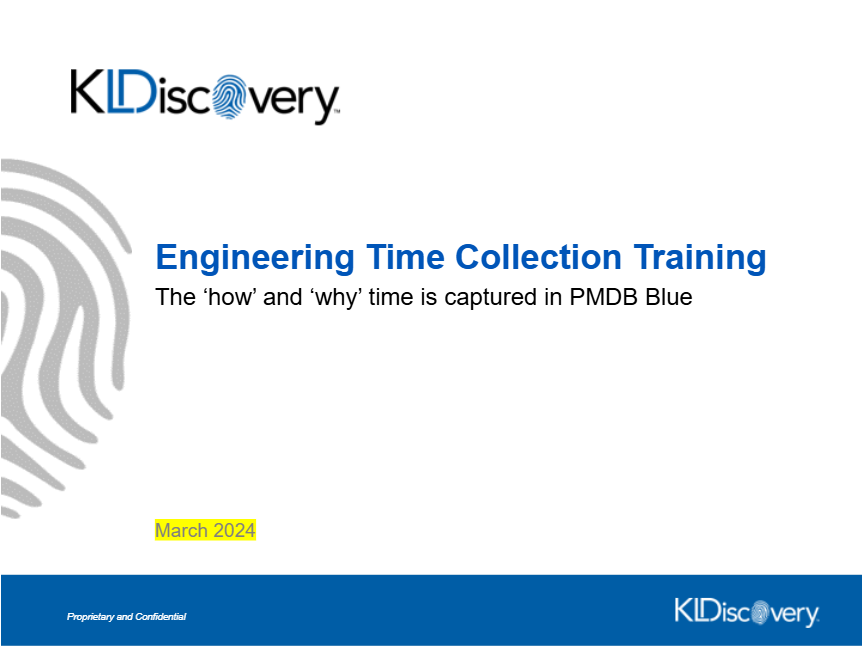

---

## Slide 2 – Why Time Collection?

**Section 1 – Why Time Collection?**

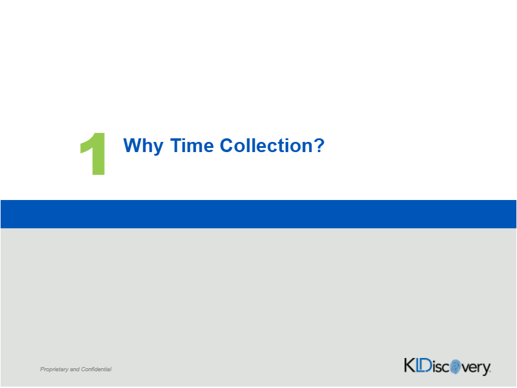

---

## Slide 3 – Time Collection Benefits

### Reasons we capture Engineering time

- Allows us to know how much an investment costs
  - Evaluate how much we spend on initiatives
  - Understand the type of return on investment we received
  - Determine if we are investing in the right areas
- Positive impact on KLD’s EBITDA*
  - Software capitalization recognizes internally-developed software as fixed assets
  - Accounting rules are applied to KLD’s internal use software that is used to operate our business and provide services to our customers
  - Allows us to spread out the costs of the project over a longer period, helping the profitability of KLD

*EBITDA = Earnings Before Interest, Taxes, Depreciation, and Amortization*

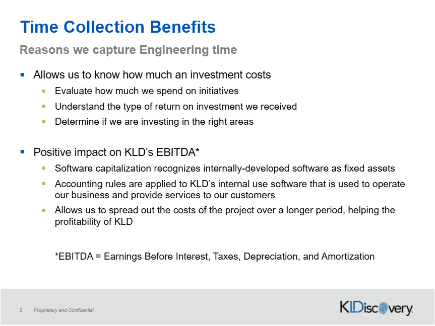

---

## Slide 4 – Categorizing Time

**Section 2 – Categorizing Time**

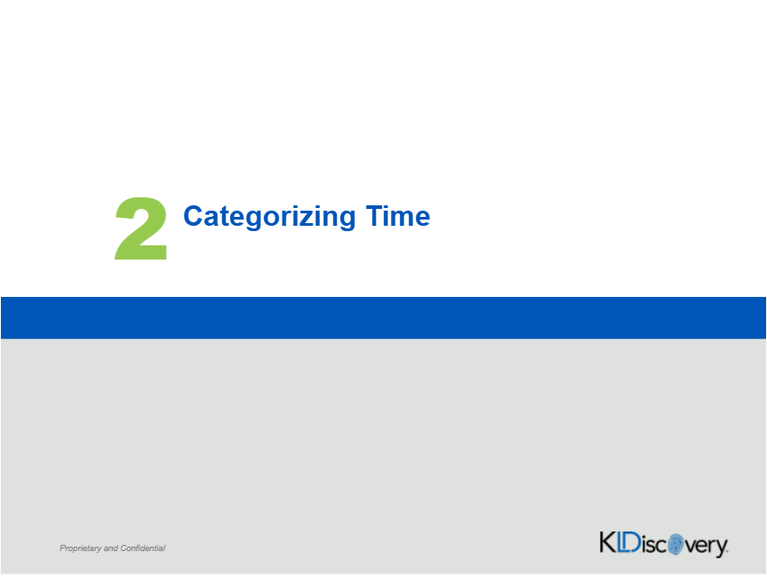

---

## Slide 5 – Time Categories in PMDB Blue

### There are 3 main categories to track time against

- Paid Time Off (PTO)
- General Admin
- Engineering Project

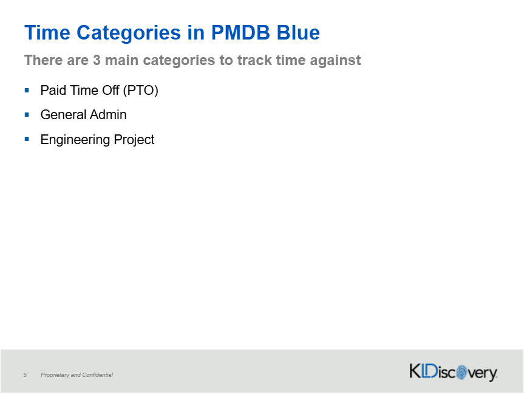

---

## Slide 6 – Time Categories in PMDB Blue

### Project Activities

- Each Engineering Project has up to 5 activities
- PMDB Blue formats the project activities as follows:
  - &lt;Project&gt; - Preliminary Project
  - &lt;Project&gt; - Application Development*
  - &lt;Project&gt; - Post Implementation
  - &lt;Project&gt; - Data Migration
  - &lt;Project&gt; - Production Support

\* Application Development is the only Project Activity that is subject to Software Capitalization.

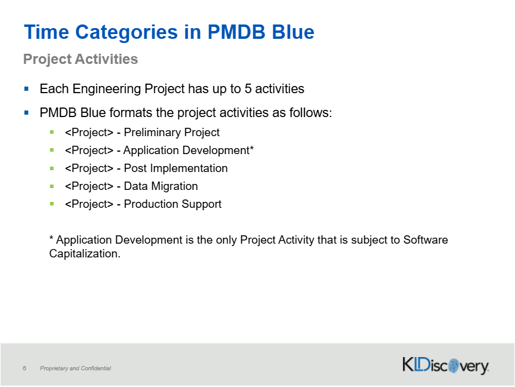

---

## Slide 7 – &lt;Project&gt; - Preliminary Project

- Specification, formulation, and/or evaluation of alternatives/options
- Determining performance and system requirements
- Determination of existence of needed technology
- Final selection of alternatives
- Training, Onboarding or mentoring directly related to learning the details of or in support of the project
- Preparing PBI description and acceptance criteria (planning, refinement) for work items that are not part of a prioritized Epic and are not in an Iteration
- Dev or QA Meetings to discuss the approach for development or testing activity
- Developing roadmaps and timelines
- Setting up your local Dev Environment in preparation for project development

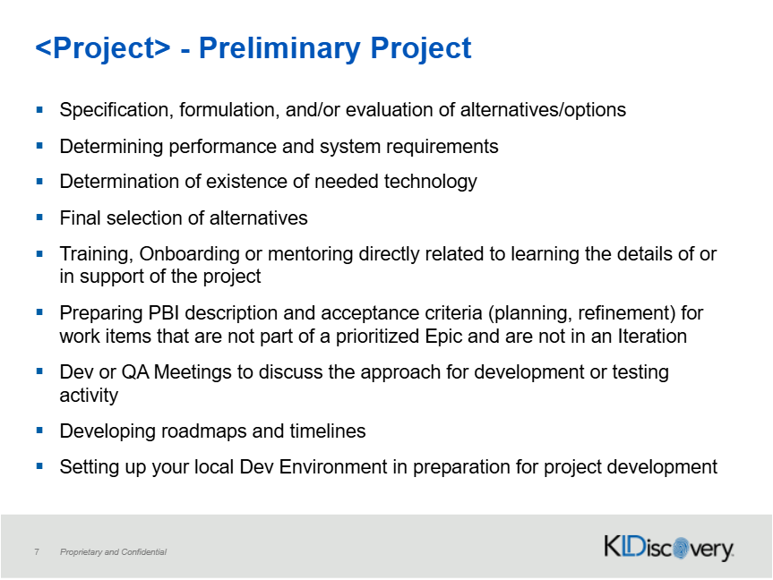

---

## Slide 8 – &lt;Project&gt; - Application Development

- Activities related to Feature Development
  - Software design including software configuration and software interface(s)
  - Coding, code review, and related bug fixes (including all aspects of the pull request process)
  - Application Testing (manual and/or automated) / User Acceptance Testing (UAT)
  - Installation or deployment of new features and/or functionality to an environment
- Upgrades that contribute additional functionality
  - Increased efficiency or performance alone is not considered additional functionality
- Development of software allowing access or conversion of old data by a new system
  - This does NOT include actual data conversion from old to new systems

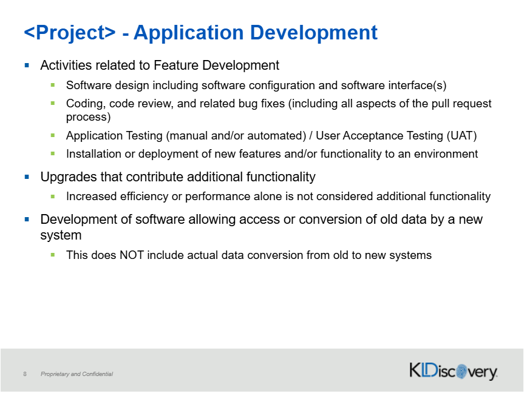

---

## Slide 9 – &lt;Project&gt; - Application Development

- Daily standup meetings actively discussing the work under development
- Backlog prioritization meetings defining the scope for the upcoming iteration
- PO / Stakeholder meetings actively discussing and reviewing the project under development
- Technical or one-time meetings that include discussions about new features and presentation of new features or discussion on tests / pipelines
- Writing documentation (Implementation Plans, design documentation, release plans, etc.) related to the project in development
- Create and/or refine PBI description and acceptance criteria for prioritized Epics starting in the Implementation Plan phase
- Refining stand alone PBIs that are part of the current iteration but are not part of a prioritized Epic
- Writing Test Cases

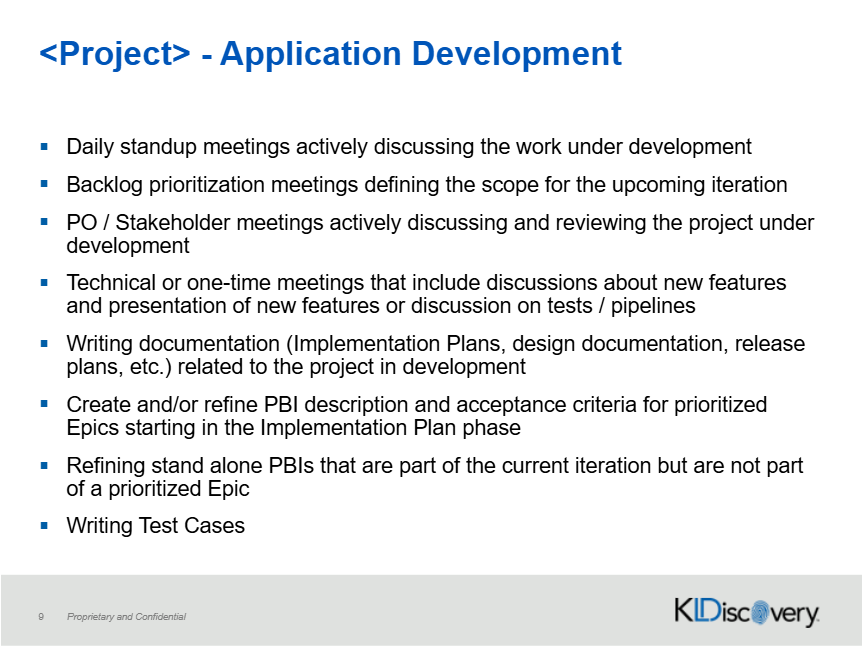

---

## Slide 10 – &lt;Project&gt; - Post Implementation

- Application maintenance
  - Bug fixes or working on issues with features already in production
  - Activities related to the bug fix that include coding, code reviews, pull requests, and testing
- Hotfixes
  - Updates to issues/errors with code that was released to production
- Training
  - Training related specifically to a feature or application
  - May include reading documentation, attending a live or recorded session
- Writing Documentation
  - Support Documentation
  - Information about the team, details, processes and procedures

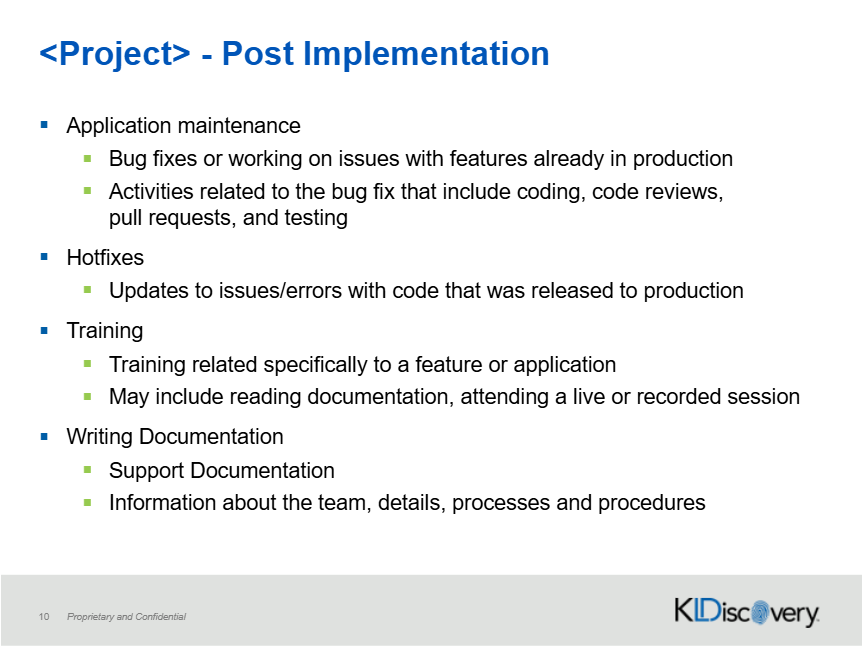

---

## Slide 11 – &lt;Project&gt; - Data Migration

- Work to migrate data from one system to another
- Migration of workspaces from one environment to another

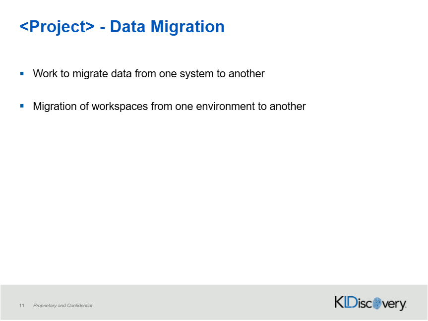

---

## Slide 12 – &lt;Project&gt; - Production Support

- Investigation into production issues not directly related to making systemic code changes
- Includes time spent to resolve and document the issue
- This is typically time spent after-hours or as designated on-call support

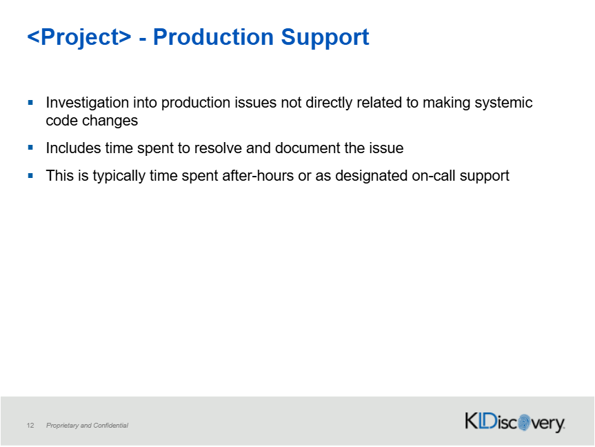

---

## Slide 13 – General Admin

- Manager 1:1 meetings and Performance Reviews
- Department and company meetings
- Department or company trainings
- Employee development including external classes and self-study
- Mentoring or training of employees not directly related to applications under development
- Quarterly Retrospectives and SWOT Analyses
- Hackathon [some exceptions may apply]
- Engineering recruitment activities
- Organizational planning or budgeting
- Onboarding activities unrelated to specific project work (for new team member or person providing training)
- Breaks (if included as part of normal working hours)
- Any other administrative time not included in other categories

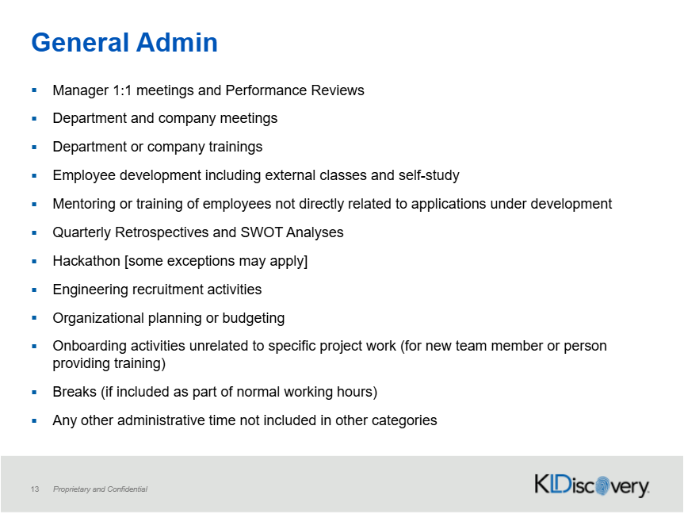

---

## Slide 14 – PTO (Paid Time Off)

- Company holidays
- Floating holidays
- Vacation
- Sick
- Bereavement, Community Service, Civic Duty, etc.
- Comp Time
  - At management discretion
  - Generally granted in situations of long support hours outside of normal work hours
  - Requires note indicating ‘comp time’

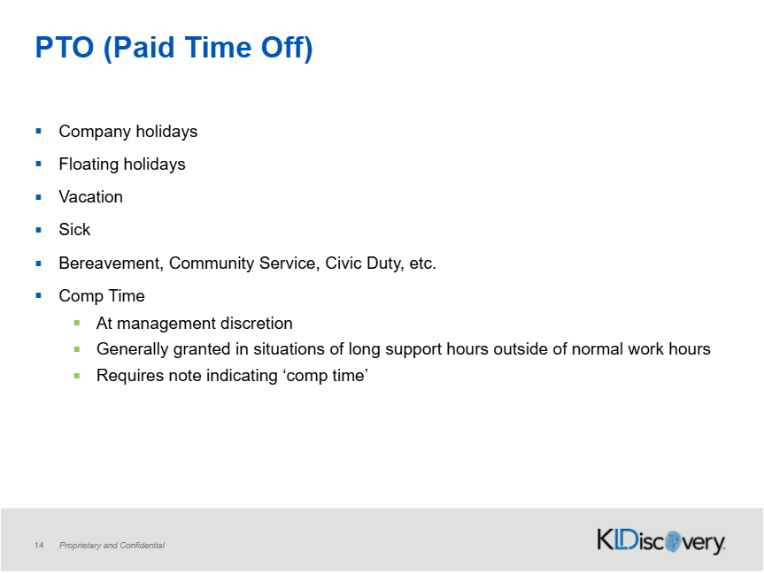

---

## Slide 15 – Time Submission, Tips & Tricks

**Section 3 – Time Submission, Tips & Tricks**

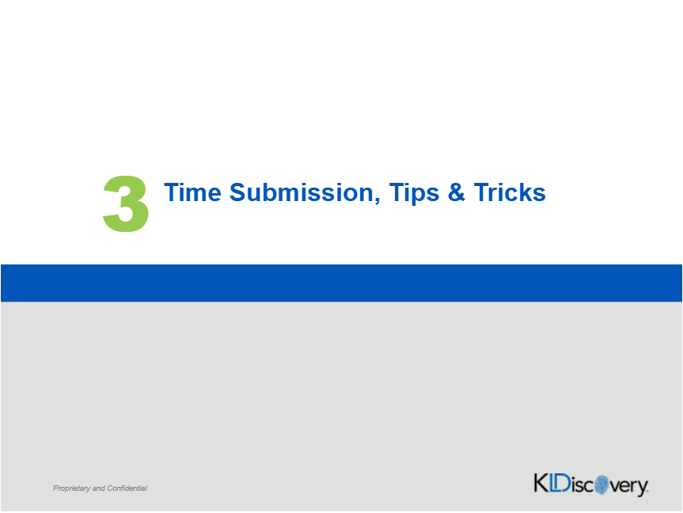

---

## Slide 16 – Time Collection – Review / Approval

- Submit time by 12 pm (U.S. Eastern) / 6 pm (Poland) every Monday
  - Any timesheets that have not been submitted, will automatically be submitted on Monday evening.
- Each week:
  - Must submit 40 hours minimum; use ‘General Admin’ or 'PTO' to get to 40 hours if needed
  - Permitted to submit over 40 hours and capture work performed
- “Description” field is optional
  - Exception:  include note when Comp time is used
- Managers should approve time by close of business every Tuesday
  - If you miss the submission cutoff, work with your manager to reject your timesheet so that you may enter/submit your time

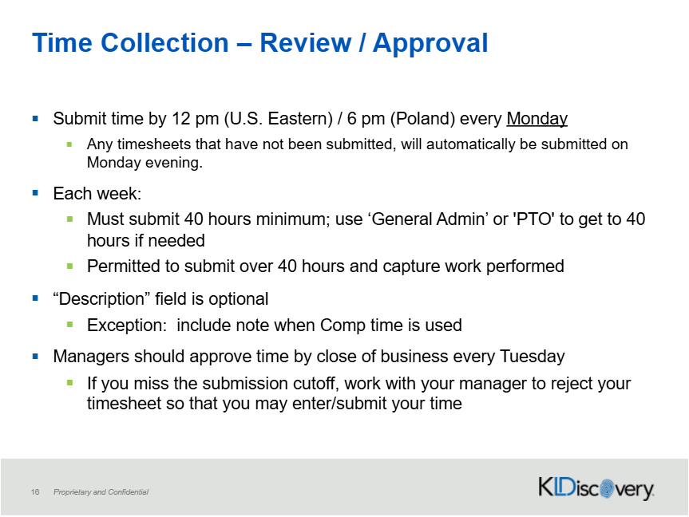

---

## Slide 17 – Time Collection – Tips for Entering Time

- Review your calendar to make sure you captured 1:1 meetings, department meetings, or all-company meetings as General Admin
  - Timecards submitted with only Application Development time for multiple weeks will be scrutinized more closely
- Enter time each day in PMDB Blue or CSV while fresh in your mind
  - Do not click “Submit” until all time is entered for the week
- Assume there is a project specific to the application you are working on; if you cannot find one in PMDB Blue, contact your Manager
- When in doubt, ask your Manager for guidance

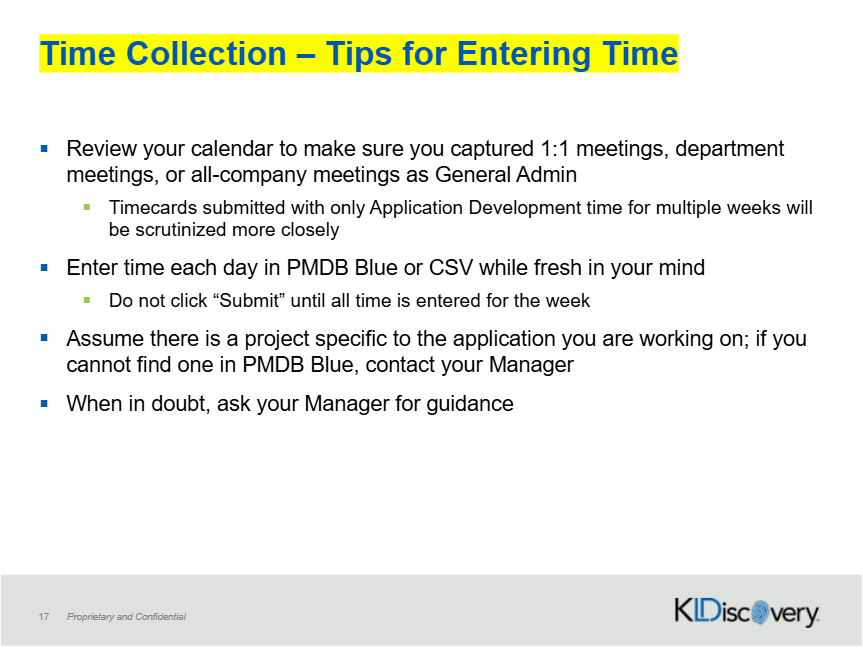

---

## Slide 18 – FAQ

**Section 4 – FAQ**

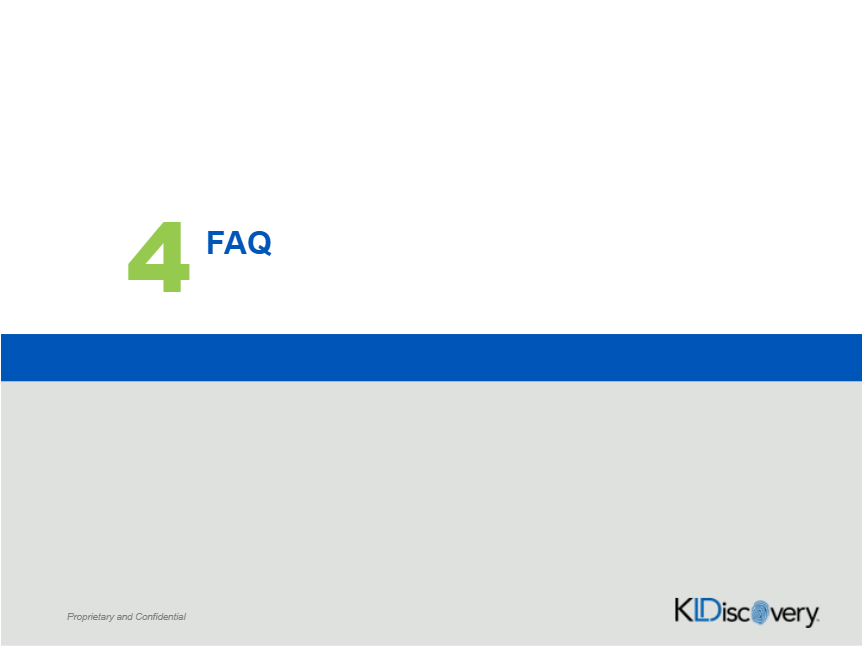

---

## Slide 19 – Time Entry - FAQ

- Why doesn’t my CSV import?
  - Check the name, dates, project ‘stages’ are all correct.  Make sure no extraneous columns/information is present on the CSV.
- Is a company holiday General Admin time?
  - No.  Company holidays are PTO.
- What category do I put bug fixes in?
  - Determine if the bug was found for a feature before or after release to production. If before, use Application Development; if after, use Post Implementation.
- What category do I put time in for the release and validation of software to a Production Environment?
  - Releasing new software to a Production Environment is Application Development.
  - If releasing a hotfix related to a bug only, all the time associated with the hotfix should be Post Implementation.

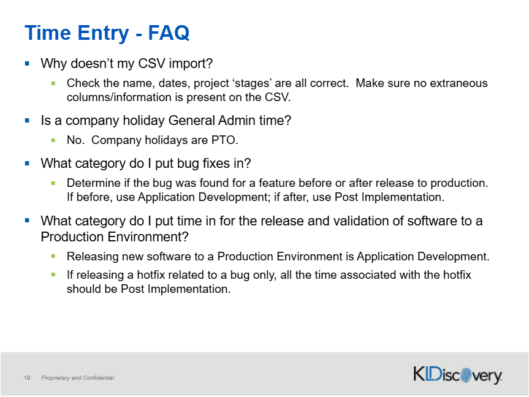

---

## Slide 20 – Time Entry - FAQ

- What category do I use for services used by multiple software solutions?
  - The time associated with new features for these services should be charged to Application Development for that application.  Some examples:
    - Native Spreadsheet Redaction (NSR) is used by Nebula and Relativity - development of the shared service should be charged to NSR – Application Development
    - Orion is consumed by multiple products and time associated to additional functionality within Orion would be charged to Orion - Application Development
    - Nebula Analytics are shared services that can be called with an input file from any source.  Time associated with these services should be charged to Nebula Analytics – Application Development
- Where do I put time for creating CRs and sending Release Emails?
  - These are release-related activities.
    - If the release is for new features / functionality – Application Development
    - If the release is for a hotfix or bugfixes for items already in production – Post Implementation
- Can I import time via a CSV?
  - Yes – instructions are at the end of this document.
- Where should I put time associated with setting up my local dev environment?
  - If related to setting up for a project, put under Preliminary Project, otherwise General Admin

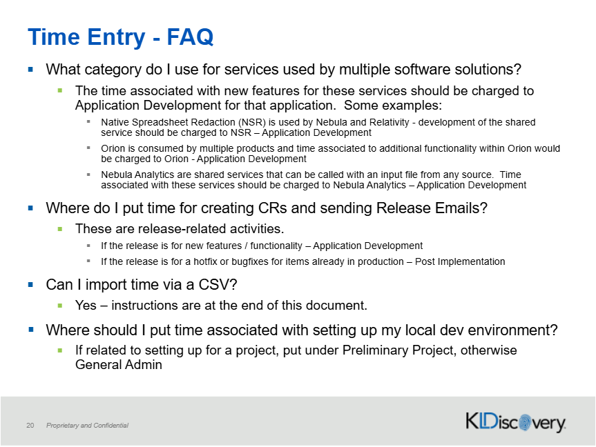

---

## Slide 21 – Time Entry in PMDB Blue

**Section 5 – Time Entry in PMDB Blue**

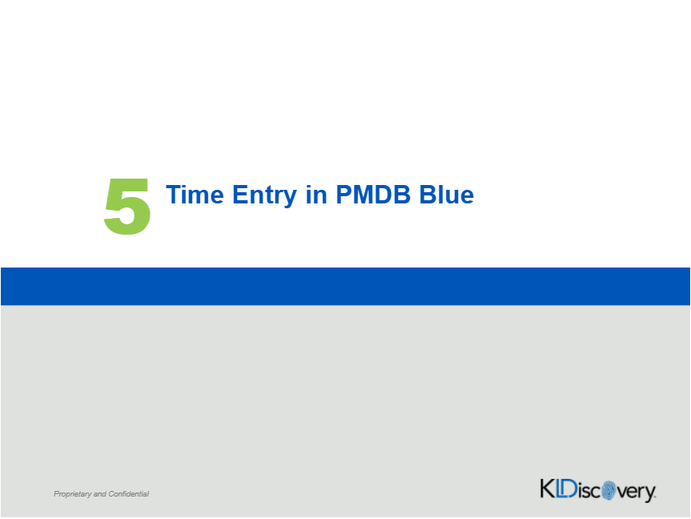

---

## Slide 22 – Time Entry Basics – Entering Time

Open PMDB Blue

<https://pmdatabase.kldiscovery.com/Login.aspx>

- Enter your username
- Enter your password

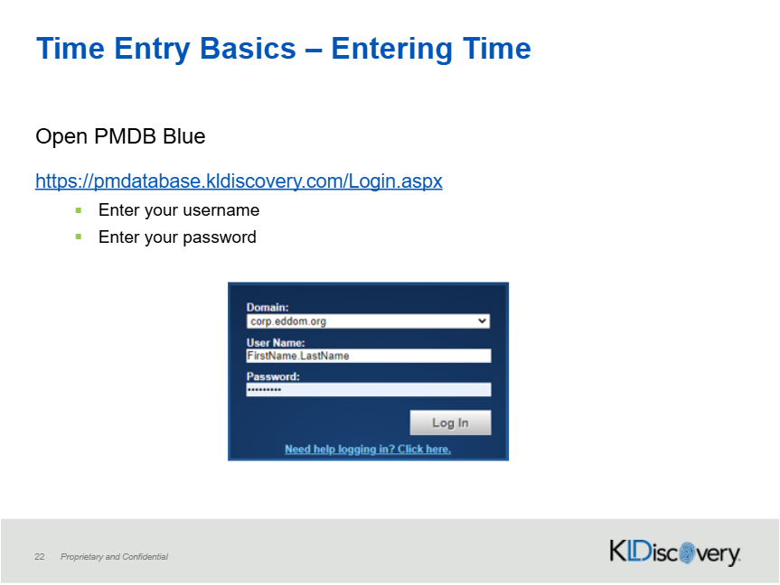

---

## Slide 23 – Time Entry Basics – Entering Time

- Go to “Software Development” across top menu and select “Time Sheet”.
- Locate the day you would like to enter time for and click “Add”.
  - Ensure the correct week\day are selected when entering time (in cases where you are attempting to enter time for the previous week)
- Click the “Plus” sign in lower left of the page.

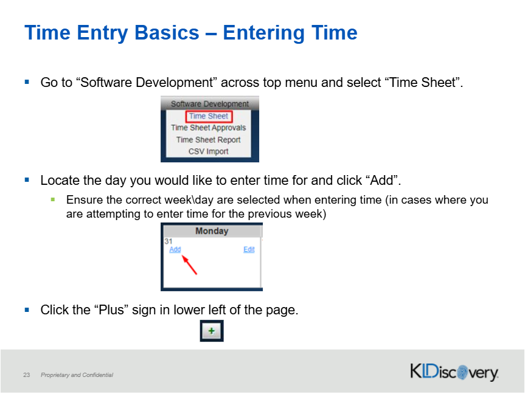

---

## Slide 24 – Time Entry Basics – Entering Time

- Fill out “Project” and “Hours” for the Dev Project; or select General Admin or PTO categories
- Click “Save”.  User is taken to a Calendar View.
- Repeat the process and enter more projects/time for each day.
- Once all time has been entered for the week, click on the Submit Week button and you are finished!

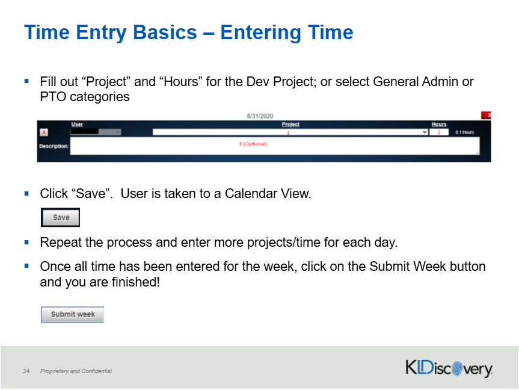

---

## Slide 25 – Time Entry Basics – Editing Time

- In “Calendar View” click “Edit” on a specific day.  The User is taken to “Project View” to edit hours, description, etc.
- In the individual “Project View”, to the left of “User”, select the “E” for Edit or “X” for Delete.
- After selecting “E” to edit, update the hours, description, etc.
- Click “Save”.

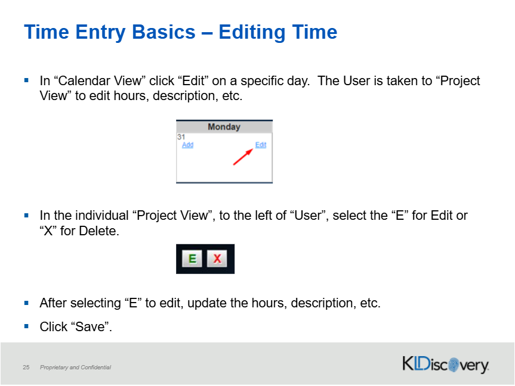

---

## Slide 26 – Time Entry Basics – CSV Import

- Go to “Software Development” across top menu and select “CSV Import”
- Download the CSV Timesheet Example (if needed)
- Add your time to the CSV template using the project names <u>exactly</u> as they appear in the project dropdown
  - E.g., “Action Coordinator - Application Development”
  - Note: You will need to strip off the curly braces {} if selecting a value from the Project dropdown in PMDB Blue to copy into this CSV.

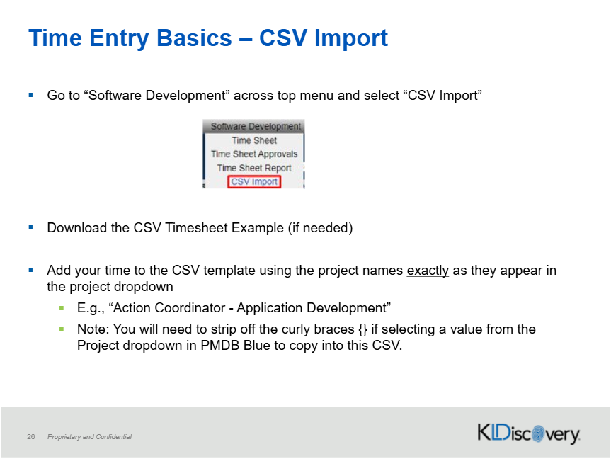

---

## Slide 27 – Time Entry Basics – CSV Import

- Choose the CSV file and click “Import”.
- If there is a green Imported sign, the import is successful.
- Errors will result in red Error entries; users must resolve all errors before entries are imported (Bad date example below)

---

## Slide 28 – Questions

**IF YOU HAVE QUESTIONS, CONTACT YOUR MANAGER FOR ASSISTANCE**

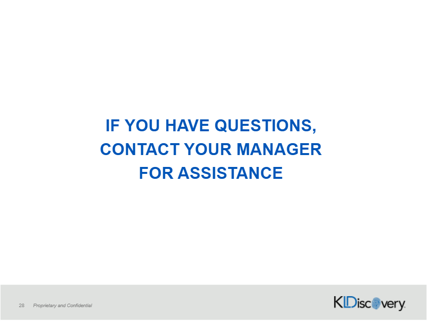

---

## Slide 29 – Revision History

| Date | Slide # | Revision |
|---|---|---|
| March 2022 | --- | None / New Document |
| March 1, 2023 | 7, 9 | Update Project Activities within ‘Preliminary Project’ and ‘Application Development’ relating to the creation / refinement of PBIs that occur at the start of the Implementation Planning phase of the project. |
| March 15, 2024 | 17, 30 | Removed reference to Team Lead. Quiz updates to provide some better feedback. |

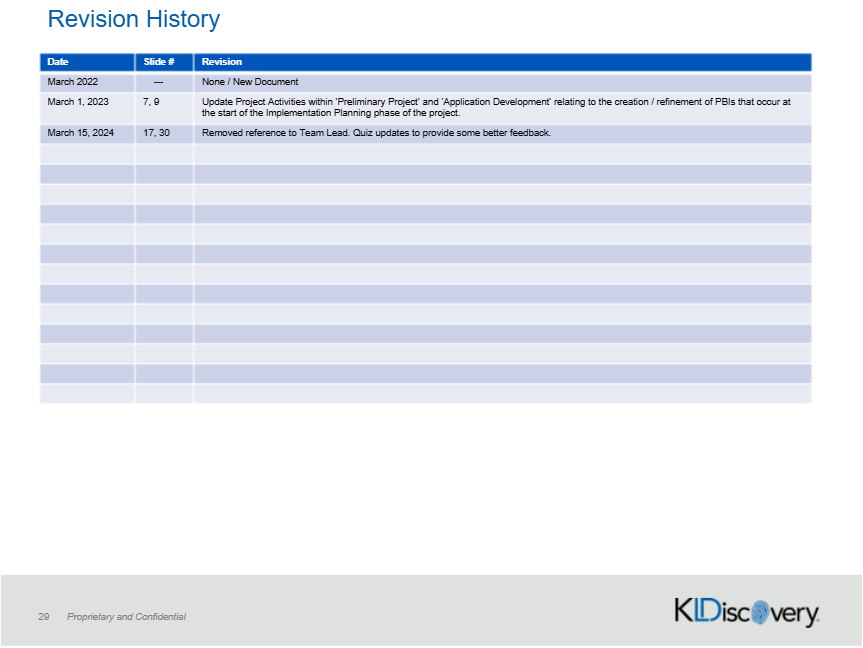

---

## Slide 30 – Time Collection Quiz

Welcome to

**"Time Collection Quiz"**

You will need to answer 4 of 5 questions correctly (80%) to pass.

> The 5 quiz questions were not extracted (graded quiz, skipped).

Click the "Start Quiz" button to proceed

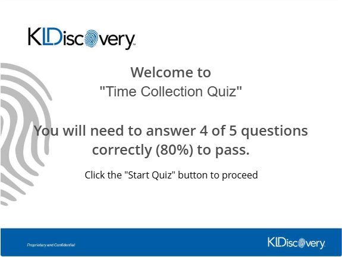

---

## Slide 31 – Thank You

**Thank you for learning with us!**

You may now close this module.

You may re-launch this module at any time to review the slides without changing your quiz results.

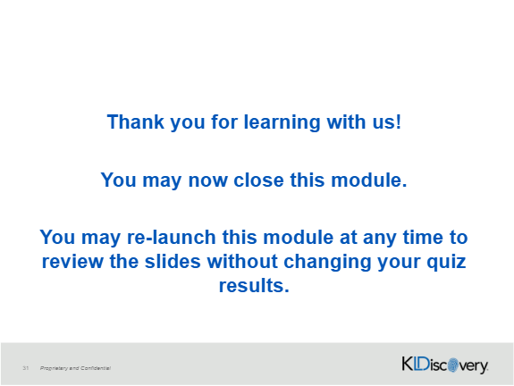
